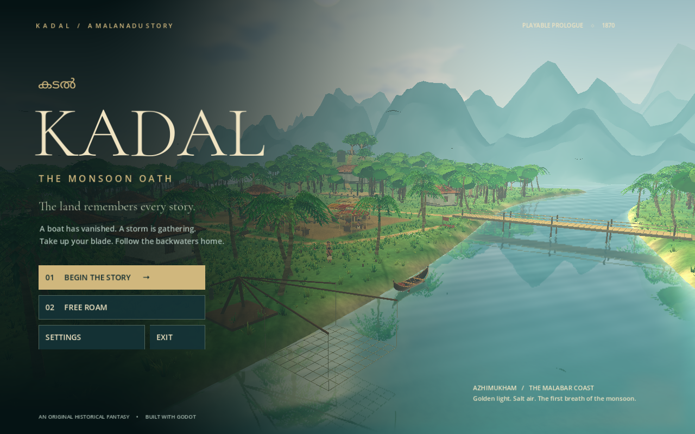

# KADAL · The Monsoon Oath

**The land remembers every story.**



A playable, offline Godot 4.3 historical fantasy prologue set on a fictional Kerala-inspired coast. You are Arun: a boatman, a kalari apprentice, and an ordinary human following the trail of a missing vanchi.

## Visual update

The reference art pass follows the [four supplied reference sheets](docs/art-direction/README.md): Arun wears a tied headband, diagonal royal-blue sash, and layered kasavu mundu; the curved Val, domed Paricha, and leaf-tipped Kuntham have new geometry. Cottages have raised stone plinths, tiled roofs, carved verandah pillars, shutters, and hanging lamps. The market has layered saffron/crimson awnings and woven spice baskets. Mossy ruins, hanging vines, tiered vilakku, curved coconut palms, and full tree crowns complete the scenery.

Characters and foliage use stepped shading with subtle rim light. Warm sunlight, softened shadows, teal mountain haze, and feathered dirt trails bring the palette closer to the lighting reference. The supplemental NPC sheets guide distinct clothing, hair, and trade accessories. That art pass preserved combat and quest rules. The newer updates below expand movement, water, wildlife, and squad combat.

[Village gameplay](docs/previews/village.png) · [Arun close-up](docs/previews/arun.png) · [Monsoon gameplay](docs/previews/monsoon.png)

[Cottage](docs/previews/cottage.png) · [Spice market](docs/previews/market.png) · [Forest ruins](docs/previews/ruins.png) · [Kuntham](docs/previews/kuntham.png)

## A lived-in coast

The new population pass adds **468 trees** with dense crowns, fern undergrowth, mossy stones, and fallen timber. Forest paths and landmark approaches have clear margins. Coconut palms now sit along the paddy edges, leaving the rice plots open.

The three paddy fields contain **3,024 wind-swaying rice clumps**, with green and ripening grain, wet beds, cross-bunds, irrigation ditches, sluice gates, harvest sheaves, baskets, a field shelter, handcarts, a scarecrow, and working farmers.

The market now has **13 stalls**, with fruit, vegetables, pottery, cloth, fish, grain, flowers, and coconuts alongside the spice sellers. Packed earth, bunting, lamps, crates, pottery, and loaded carts connect the stalls into a market square.

There are **30 friendly NPCs**, including 24 new named residents. Vendors gesture, farmers tend rice, fishers work at the water, porters carry baskets, neighbors converse, and walkers travel short routes. They greet Arun and have bilingual conversations. The six original story characters retain their roles; Meera's stall handles provision purchases.

[Market square](docs/previews/market-square.png) · [Paddy fields](docs/previews/paddy.png) · [Forest trail](docs/previews/forest.png) · [Village neighbors](docs/previews/neighbors.png)

## Malayalam voices and walking

All **30 friendly NPCs and 12 soldiers** speak Malayalam when you approach. The game includes **114 bundled speech clips**, matching Malayalam subtitles, speaker names, and an optional English translation. Every villager has distinct conversations about their work and surroundings. Return visits rotate lines; later greetings can mention rain, storms, or the recovered ledger. Soldiers challenge you, call for help, and issue orders during combat.

Villagers greet within about four metres; soldiers call out within about ten metres. Solid walls and large height differences block new greetings. One character speaks at a time, with individual and squad cooldowns. Opening a conversation replaces the nearby chatter; **Tell me more** cycles through that character's other voiced lines. **Settings → Dialogue volume** adjusts speech, and the translation switch hides the English subtitle while keeping Malayalam visible. Playback works offline.

Pedestrians and soldiers use a fuller stride at slow speeds, planted stance steps, lifted swing steps, articulated knees, and opposite arm swings. Their gait follows actual distance travelled, including sideways movement and stops. Farmers keep their work pose while standing and walk upright between tasks.

[Malayalam at the market](docs/previews/malayalam-market.png) · [Soldier callouts](docs/previews/malayalam-soldiers.png) · [Voiced conversation](docs/previews/voiced-conversation.png) · [Walking preview](docs/previews/npc-walking.gif)

## Soldiers, squads, and difficulty

**Twelve soldiers** now defend the forest route in three escalating encounters:

| Encounter | Level | Soldiers |
|---|---:|---:|
| Bridge scouts | 1 | 3 |
| Forest patrol | 2 | 4 |
| Captain's camp guard | 3 | 5 |

Squadmates alert together, approach from different angles, avoid nearby obstacles, and overlap their attacks. Spearmen have longer reach; swordsmen close in with sword and shield; the captain has stronger health, damage, and a guard that heavy blows can break. Higher levels increase soldier health and damage and shorten their preparation and recovery. Warning rings appear before each committed strike, and soldiers stop tracking your dodge late in the windup.

Choose **Easy, Normal, or Hard** under **Settings → Combat difficulty**, from the main menu or pause screen. Easy allows two attackers with longer warnings and softer blows; Normal allows three; Hard allows four with tougher soldiers and faster attacks. Changing difficulty applies immediately, preserves each soldier's health percentage, and cancels pending strikes before play resumes. The setting is saved between launches.

The HUD and map show squad levels and encounter progress. Soldier health appears when injured or locked onto; the captain stays marked. Each routed squad grants bonus fanam and one healing herb. The ruined camp has a wide gateway and a walkable entry ramp, with the guards routing through the opening before spreading out. Soldiers retreat to their posts when you escape their area or die; surviving soldiers recover at their posts, while defeated soldiers stay defeated until a new run. Clear the captain and all four camp guards to recover the ledger. Scout and patrol kills do not bypass that requirement.

[Squad combat](docs/previews/squad-combat.png) · [Group attack animation](docs/previews/squad-combat.gif) · [Captain's guard](docs/previews/captain-guard.png) · [Difficulty settings](docs/previews/combat-difficulty.png)

## Wildlife and the hill temple

**Four cats, three dogs, five spotted deer, and two elephants** now inhabit the island. Cats and dogs wander near village homes and the market, and turn toward Arun when he approaches. Deer graze in the east-bank woodland and the grove north of the bridge; they startle and run when approached. Elephants roam two open clearings in the western forest. Their ears, tails, legs, and segmented trunks animate independently. Animals avoid solid scenery, stay near their habitats, and pause during menus and conversations.

The hilltop shrine at **Malayoram** is now a Kerala-inspired timber temple with two terracotta roof tiers, brass finials, carved veranda pillars, shuttered walls, a stone courtyard, a roofed gateway, a hanging bell, oil lamps, and flower offerings. Follow the westward hill trail past the lookout, then climb the stone approach through the gateway. Rest in front of the sanctum with **E** to restore health and stamina; the first discovery still awards 50 fanam.

[Hill temple](docs/previews/hill-temple.png) · [Temple courtyard](docs/previews/temple-courtyard.png) · [Village pets](docs/previews/wildlife.png) · [Deer](docs/previews/deer.png) · [Elephant](docs/previews/elephant.png)

## Water, movement, and vanchi update

The backwater now renders actual mirrored scenery in a separate 768-pixel-wide view at up to 30 updates per second. The water combines these reflections with depth-dependent transparency, refraction, a subtle caustic pattern, fine wave distortion, shoreline foam, rain rings, and a moving V-shaped boat wake. Submerged character and hull geometry is clipped from the reflection; the main camera still sees it through the shallows. Reflections fall back to the sky when the camera goes underwater.

Arun and the other procedural characters now have articulated elbows and knees. Walking and running blend with speed; turning adds a small body lean, jumps tuck the legs, landings compress the pose, and dodges curl into the roll. Swimming and ladder climbing use their own poses and stow held weapons. Ground movement accelerates smoothly, stops firmly, and has gentler steering in the air.

The vanchi has a curved planked hull, raised stems, continuous gunwales, interior ribs and floorboards, slatted seats, rope coils, and a bundled cloth roll. Arun sits on the animated seat and reaches toward both paddle grips. Paddle strokes, blade splashes, hull bobbing, turning roll, smooth steering, and gradual coasting connect the animation to the controls.

[Reflective backwater](docs/previews/water.png) · [Vanchi close-up](docs/previews/boat.png) · [Paddling animation](docs/previews/paddling.gif) · [Running animation](docs/previews/running.gif)

## Open and play

1. Double-click **Play KADAL.command** in this folder. Godot is already installed on this Mac.
2. Choose **Begin the Story** for the investigation, or **Free Roam** to explore the same world without activating the quest.
3. In Story Mode, read the prologue, select **Find Ravi**, then follow the gold diamond to the boatman.
4. Press **Esc** to release the mouse and open the pause menu. To switch modes, return to the main menu.

To edit: open Godot, select **Import**, choose this folder's `project.godot`, then press **F5**. The scenery is generated when the game runs; an empty main scene in the editor is expected. First import may take a few seconds.

Terminal alternative:

```sh
cd "/Users/apple/Desktop/GameJam 2"
godot --headless --path . --editor --import --quit
godot --path .
```

No accounts, online services, API keys, plugins, or paid assets are needed during play.

## Controls

| Input | Action |
|---|---|
| W A S D | Camera-relative movement; paddle / steer while boating |
| Mouse | Rotate camera |
| Mouse wheel | Adjust camera distance |
| Shift | Sprint; consumes stamina |
| Space | Jump; swim upward near the surface |
| Q | Dodge roll with a short defensive window |
| Left click | Light attack; click during recovery to queue the next combo cut |
| F | Heavy attack; breaks an elite's guard |
| Right click, hold | Guard toward the character's facing direction |
| Right click, timed | Perfect parry: block within 0.2 seconds of a hit |
| Tab | Toggle lock-on to a nearby enemy |
| 1 / 2 / 3 / 4 / 5 | Sword & shield / spear / staff / dagger / urumi |
| E | Talk, inspect, gather, open doors or chests, board / leave boat |
| C | Climb at the highland lookout's ladder |
| H | Use a healing herb; restores 45 health |
| I | Satchel and weapon selection |
| M | Map, landmarks, player position and story objective |
| Esc | Pause / close a panel |
| F6 | Cycle weather; also available in Settings |

After a perfect parry, the attacker staggers and your next hit within 2.5 seconds deals extra damage. Guarding requires stamina and facing the attacker. Recover stamina by lowering your guard. The elite blocks light attacks during recovery: use heavy attacks or reposition.

## The playable adventure

The compact island is approximately **280 metres across**, with five connected areas. There are no scene loads between them.

- **Azhimukham:** tiled houses with opening doors, interiors, a banyan meeting place, fishing nets, a busy market with 13 stalls, villagers, and a provision shop.
- **Kayal:** winding backwater, working vanchi, wooden bridge, planted and irrigated paddy fields with workers, and the torn-sail clue.
- **Vanam:** trees, stone lamps, a waterfall, ruins, three escalating soldier squads, and a level 3 captain guarding the cargo ledger.
- **Malayoram:** elevated trails, a climbable lookout, hidden supplies, and a detailed restorative hill temple.
- **Kotta:** an open kalari courtyard, instructor, estate, and practice post that responds to every weapon.

**Story route:** Ravi → Meera → red sail beside the water → bridge → scouts → forest patrol → captain and four camp guards → ledger → Ravi. The ending grants 150 fanam and leaves the world open for exploration. Clearing the camp early is supported.

Free Roam uses the same locations, movement, shop, enemies, boat, shrine, collectibles, and weather, without automatic story progression.

## Effects and feedback

| Action | Presentation |
|---|---|
| Sword | Alternating crescent cuts, edge streaks, three-stage combo and heavier finisher |
| Spear | Narrow thrust streaks, extended reach, distinct airy thrust sound |
| Staff | Broad sweep, ground dust, low wooden swish |
| Dagger | Short, fast diagonal cuts and quick recovery |
| Urumi | Animated flexible blade, overlapping ribbons of steel, wide sweep and longer recovery |
| Hit / heavy hit | Debris, hit flash, damage number, knockback, stagger, brief hit pause and adjustable shake |
| Guard / perfect parry | Metal sparks, ringing impact, expanding flash, attacker stagger and counter opportunity |
| Movement | Joint-driven walk and run, full dodge rotation, jump / landing dust, swimming strokes and water ripples |
| Boat | Bobbing, steering, acceleration, trailing wake and disembark |
| World interactions | Gathering motes, healing leaves, chest burst, discovery chime, opening doors |
| Monsoon | Local rain volume, wet material response, water ripples, rain ambience, fog, lightning and thunder in heavy rain |

Sound effects and coast / bird ambience are original procedural WAV files. Malayalam dialogue uses bundled synthesized MP3 speech. Clouds and rain change over time; Settings can select weather immediately.

## Edit the game

- **Characters and motion:** `scripts/player/avatar.gd` holds the animation joints. `scripts/player/avatar_art.gd` builds the models and combines their visual pieces per joint. Replace the visual child with an imported character while keeping the controller's forward direction at **-Z**, feet at **Y = 0**, and the attack / guard animation methods. Characters use articulated procedural joint motion rather than imported animation rigs; `animate()`, `swim_pose()`, `climb_pose()`, and `paddle_pose()` handle their movement states.
- **Player and camera:** `scripts/player/player.gd`. The spring arm handles world collision; mouse sensitivity is in Settings.
- **Weapons:** `data/weapons.json` holds damage, reach, stamina, timing and strike angle. `scripts/combat/combat.gd` resolves timed hits once per target and checks world occlusion. Add a matching model in `avatar.gd` and effects in `scripts/combat/effects.gd` when adding another weapon type.
- **Dialogue:** `data/dialogues.json` and `data/villagers.json` hold character introductions and follow-ups. `data/speech.json` holds all spoken lines and character / context pools; keep its `intro` / `more` text in sync with the corresponding character record. After changing Malayalam, run `python3 tools/generate_speech.py` with gTTS installed to regenerate changed clips. `scripts/managers/speech.gd` handles proximity, occlusion, rotation, voice playback and subtitles; generated text and audio hashes are in `data/speech_manifest.json`. NPC placement is in `Malanadu.populate()` inside `scripts/world/world.gd`.
- **Quest and inventory:** `scripts/managers/game.gd` owns the run state, objectives, herbs, fanam and purchases. `scripts/main.gd` connects world interactions to the quest. Run state resets on a new Story / Free Roam session.
- **Population and farming:** `scripts/world/settlement_life.gd` builds forest clusters, the expanded market, and rice fields. `data/villagers.json` defines the additional villagers, conversations, clothing, and routes; `scripts/npcs/villager.gd` animates their activities and greetings.
- **Wildlife and temple:** `scripts/wildlife/wildlife.gd` places the animals and reserves open habitats. `animal.gd` handles collision, wandering, grazing, curiosity, flight and joint animation; `animal_art.gd` builds the four species. `scripts/world/hill_temple.gd` builds the elevated courtyard, detailed temple and sloping approach.
- **World:** `scripts/world/scenery_art.gd` builds reusable roofs, foliage, awnings, and rocks. `scripts/world/world.gd` builds the heightfield, modular buildings, paths, foliage, landmarks and interactables. `height_at()` is shared by placement and swimming checks. `scripts/enemies/encounters.gd` defines squad positions, levels, roles, shared alerting, concurrent attacks, and encounter rewards; `enemy.gd` handles movement and strikes. `Game.DIFFICULTIES` holds the three difficulty profiles.
- **Boat and reflections:** `scripts/vehicles/boat_art.gd` builds the hull and paddle; `scripts/vehicles/boat.gd` controls steering, coasting, strokes, and rider markers. `scripts/world/water_reflection.gd` renders the mirrored view and updates waterline clipping on the shared materials.
- **Weather:** `scripts/weather/weather.gd`; water / foliage / waterfall shaders are in `shaders/`.
- **UI:** `scripts/ui/interface.gd` and `scripts/ui/cartography.gd`.
- **Audio:** run `python3 tools/generate_audio.py` to regenerate the original sound library. Godot automatically reimports the WAV files.

Input actions are registered centrally through Godot's Input Map in `game.gd`. Meshes and materials are shared. Repeated static scenery is batched into MultiMeshes; interactable objects retain separate nodes. Grass uses a MultiMesh with a lightweight wind shader. The default renderer is Compatibility with FXAA and one shadowed sun.

## Validation

Tested with **Godot 4.3 stable, Compatibility / OpenGL, Apple M3**. See `docs/TEST_RESULTS.md` for the final results.

```sh
# Import and parse project resources.
godot --headless --path . --editor --import --quit

# Gameplay systems, economy, modes, quest and combat checks.
godot --path . --quit-after 1800 -- --smoke

# Soldier group attacks, difficulty caps, telegraphs, parries, retreat and reset.
godot --path . --max-fps 60 --quit-after 3000 -- --soldiers

# Offline voices, proximity, subtitles, conversations, cooldowns and NPC gait.
godot --path . --max-fps 60 --quit-after 2500 -- --speech

# Also capture voiced conversations, soldier subtitles, settings and walking.
godot --path . --resolution 1280x800 --max-fps 60 --quit-after 2500 -- --speech --capture-speech

# Actual physics updates and held-input movement / boat / climbing checks.
godot --path . --max-fps 60 --quit-after 5000 -- --integration

# Render a reproducible visual tour to artifacts/*.png.
godot --path . --resolution 1280x800 --max-fps 60 --quit-after 3000 -- --capture

# Water, boat, and movement close-ups plus warmed rendering samples.
godot --path . --resolution 1280x800 --max-fps 60 --quit-after 4200 -- --capture --water-motion

# Soldier squads, overlapping attacks, difficulty settings and combat samples.
godot --path . --resolution 1280x800 --max-fps 60 --quit-after 3000 -- --capture --squads

# Wildlife portraits, hill temple, monsoon courtyard, and warmed rendering samples.
godot --path . --resolution 1280x800 --max-fps 60 --quit-after 2400 -- --capture --wildlife

# Village life, market, paddy workers, and forest captures.
godot --path . --resolution 1280x800 --max-fps 60 --quit-after 4200 -- --capture --population
```

Godot 4.3 has a known dummy-renderer mesh cleanup issue that prints `Parameter "m" is null` when these 3D tests run with `--headless`; see [Godot issue #86806](https://github.com/godotengine/godot/issues/86806). Use the rendered commands above for a clean gameplay test log. The import check runs headlessly.

## Current limits

This is a functional **stylized procedural prototype**, not finished AAA character or environment art. The scene uses original stylized meshes, shaders, and procedural joint animation. Dialogue is synthesized Malayalam with per-character pitch variation, rather than a human voice cast or lip-synced performance. It does not include mocap, authored anime facial animation, NPC daily schedules, complex enemy navigation, a general climbing system, a complete day / night cycle, fishing gameplay, or a save-game system. Lighting changes gently over time; weather is the main atmospheric cycle. Settings save audio, subtitle translation, difficulty, camera sensitivity and shake; progress resets when starting a new run or closing the game.

The merchant sells herbs and three levels of weapon honing. The map is a simple field chart. Boat motion is kinematic, with separate visual buoyancy and a procedural two-hand paddle pose. The waterfall uses layered translucent water curtains over modeled rock ledges. Malayalam glyphs and shaping are bundled and visually checked; native-speaker editorial review is still recommended before publication. Historical / martial references are fictionalized, not a reconstruction or training guide.

The next high-value production work is an original rigged hero, richer hand-authored foliage / buildings, more combat animation, and a longer rescue sequence. See `docs/VISION.md` for the improved creative direction and `docs/DEVELOPMENT.md` for the build stages.

## Credits and licences

Original code is provided under the MIT licence in `LICENSE`. Original procedural meshes, shaders, icon and synthesized effects are part of this project. Speech generation and asset provenance are recorded in `assets/ASSET_SOURCES.md`. Bundled **Cormorant Garamond** and **Noto Sans Malayalam** use the SIL Open Font License; their full notices are in `assets/fonts/`.
